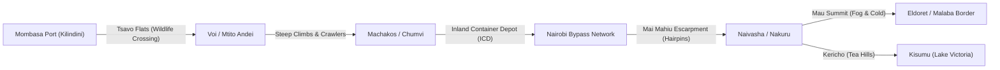
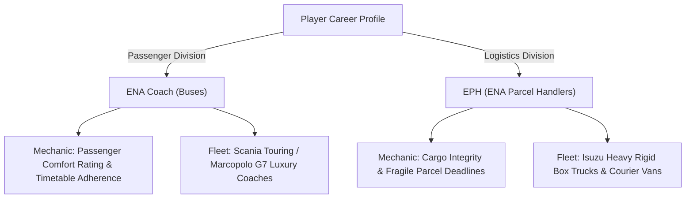
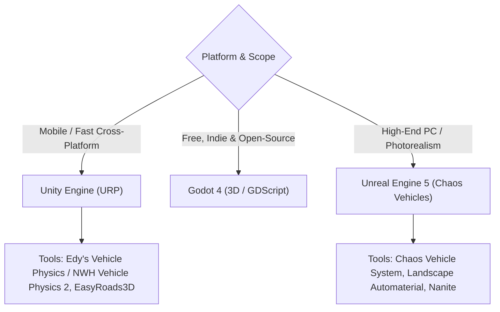

# Project Blueprint: Kenya Truck Simulator ("Safari Hauler")

A simulation game capturing the grit, beauty, and challenges of long-haul trucking across East Africa’s busiest transit network: **The Northern Corridor**.

---

## 1. Core Vision & Cultural Identity

Unlike European highways with predictable lane discipline and uniform rest stops, trucking in Kenya is an adventure shaped by dramatic topography, bustling roadside commerce, and distinct road etiquette.

### Key Atmospheric Elements
- **Iconic Mudflaps & Slogans**: "No Hurry in Africa", "God's Grace", "Utavumilia", "Beba Beba".
- **Heavy Modifications**: Heavy-duty front bull-bars (*kikapu*), high-mounted spotlights, extended exhaust stacks, canvas tarps secured with sisal ropes.
- **Soundscape**: FM radio simulation with local benga, gengetone, and talk shows; engine exhaust brakes (*Jake brakes*); engine hiss; distant wildlife at night; roadside vendors calling out.
- **The Ecology of the Road**: Roadside tire repair shops (*pinchering/gumtre*), makeshift weighing checkpoints, and informal tea/mandazi stops.

---

## 2. World & Map Design

### Key Geographic Regions
1. **The Coastal Plains (Mombasa & Tsavo - A104/A8)**
   - High humidity, red soil, flat long-distance driving.
   - Hazards: Night-time elephant/wildlife crossings near Tsavo, heavy container traffic.
2. **The Great Rift Valley Escarpment (Mai Mahiu & Salgaa)**
   - Perilous mountain passes, sheer drop-offs, switchbacks with views of Mt. Longonot.
   - Hazards: Severely overloaded uphill lorries crawling at 10–15 km/h with flashing hazard lights; brake fade on descents.
3. **The Highlands (Mau Summit & Timboroa)**
   - High altitude (2,600m+), thick mountain mist, pine forests, wet asphalt.
4. **The Sugar & Tea Belts (Kericho to Western Kenya)**
   - Winding green estates, tractors pulling multiple sugarcane trailers.

---

## 3. Authentic Gameplay Mechanics

### 1. Weighbridges & KeNHA Regulations
- Static weighbridges at **Mariakani**, **Athi River**, and **Gilgil**.
- Players must maintain legal axle weights. Overloaded loads pay significantly higher cargo fees but carry severe risks of fines or impoundment at KeNHA stations.

### 2. Road Hazards & Road Realism
- **Improvised Warning Signs**: When an AI truck breaks down, tree branches are placed on the asphalt 50 meters back instead of reflective triangles.
- **Unmarked Speed Bumps & Rumble Strips**: Giant asphalt mounds before small towns that damage your suspension if hit at cruising speed.
- **Police & NTSA Checkpoints**: Random speed gun traps and vehicle fitness inspections (fire extinguisher, working tail lights, reflective stickers).

### 3. Dynamic Traffic AI Behavior
- **Matatus (HiAce / Minibuses)**: Aggressive overtakes on blind corners, sudden stops along the curb for passengers.
- **Boda-Bodas (Motorcycles)**: Weaving between lanes at junctions, carrying oversized cargo (goats, bananas, mattresses).
- **Probox Logistics**: Unpredictable high-speed rural transport vehicles.

---

## 4. Vehicle Classes & Dual Fleet: The ENA Ecosystem

The game centers around the real-world Kenyan transport giant **ENA Coach** and its dedicated logistics wing **EPH (ENA Parcel Handlers)**. Players can choose their career track between passenger express transport and high-stakes courier delivery.

### 1. ENA Coach (Luxury Long-Distance Bus)
- **Role**: Premium passenger transport between Nairobi, Nakuru, Kericho, Kisii, and Kisumu.
- **Handling**: High top-end highway cruising speed (capped at 80–90 km/h as per NTSA rules), longer braking distance, smooth air suspension, pneumatic door controls.
- **Key Mechanic — Passenger Comfort Score**:
  - Hitting speed bumps without braking triggers passenger complaints: *"Dereva, punguza mwendo!"* (Driver, slow down!).
  - Reckless overtaking reduces passenger satisfaction and tip bonuses at the arrival stage.
- **Audio**: Multi-tone chime air horn (*Pah-pa-pa-pah*), passenger ambient murmur, air-suspension kneeling hisses.

### 2. EPH (ENA Parcel Handlers - Cargo & Logistics)
- **Role**: Express parcel freight transporting electronics, agricultural samples, spare parts, and personal parcels from the Nairobi CBD parcel hub to upcountry destinations.
- **Handling**: Heavier box body with realistic roll center; more sensitive to cargo shifting on sharp turns.
- **Key Mechanic — Cargo Integrity**:
  - Speed bump jolts and sudden swerves damage fragile cargo.
  - Waybill system: Deliver parcels on-time to EPH branches at regional depots to earn KES and unlock heavier delivery trucks.
- **Audio**: Deep pneumatic heavy truck horn, rattling parcel crates inside the box bed on uneven roads.

---

## 5. Technology Stack Recommendations

### Engine Evaluation
- **Unity (Recommended for MVP)**:
  - Proven for commercial vehicle simulators on both PC and Mobile.
  - Large marketplace for road generation tools (`EasyRoads3D`), vehicle dynamics (`Realistic Car Controller Pro` or `NWH2`), and weather systems.
- **Unreal Engine 5**:
  - Unmatched visual fidelity for the Great Rift Valley, but high hardware requirements for players and steep terrain optimization curves.
- **Godot 4**:
  - Clean and lightweight if you are building a stylized indie simulator or targeting low-spec PCs.

---

## 6. MVP Roadmap (Phase-by-Phase)

### Milestone 1: The Driving Prototype (2–3 Weeks)
- Set up vehicle physics (acceleration, suspension bounce, dual-axle turning, air brakes).
- Build a 5 km test track featuring: flat straightaway, high-grade incline, speed bump, and off-road gravel patch.
- Implement cabin view with functioning side mirrors and simple dashboard gauges.

### Milestone 2: The Mai Mahiu Strip (3–4 Weeks)
- Construct a single scenic route (e.g., from Limuru down the escarpment into Mai Mahiu town).
- Implement basic day/night cycle and heavy fog weather condition.
- Add AI traffic: one standard passenger car, one matatu, and one slow-moving heavy lorry.

### Milestone 3: Cargo & Economy (3 Weeks)
- Implement Job Board: Pick up container in Nairobi ICD -> deliver to Naivasha Inland Depot.
- Implement fuel consumption, repair damage costs, and delivery payout in Kenya Shillings (KES).
- Add simple KeNHA weighbridge trigger.

### Milestone 4: Polish & Flavor (4 Weeks)
- Localized audio (engine brakes, Swahili voice overs, radio stations).
- Customization shop: Add bull-bars, mudflaps with slogans, roof LED lightbars.
